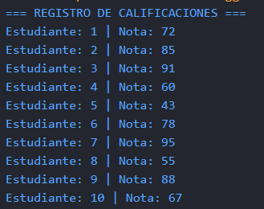
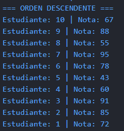
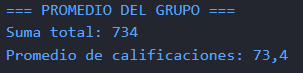
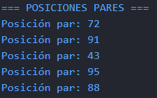
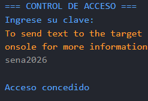
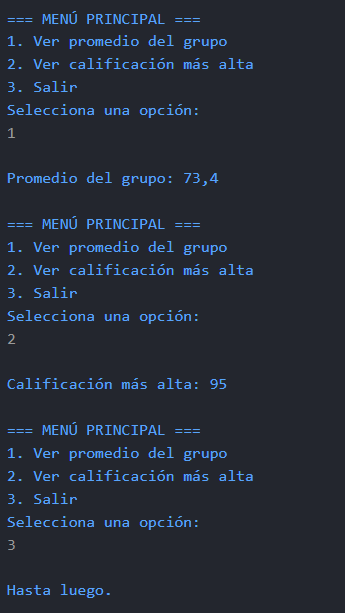
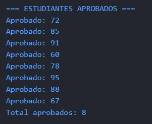
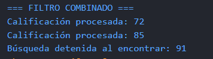

# Reto Estructuras de Control Iterativo en C#
## Descripción del trabajo

En este trabajo realicé un programa en C# para trabajar con las calificaciones de un grupo de estudiantes. El objetivo fue poner en práctica los bucles `for`, `foreach`, `while` y `do-while`, además de utilizar las instrucciones `break` y `continue`.

El programa está dividido en tres secciones, en las cuales se realizan diferentes operaciones con las calificaciones y se utilizan las estructuras de control vistas en clase.

## Sección 1. Registro y análisis de calificaciones

En esta sección creé un array llamado `calificaciones` con diez notas. Utilicé el bucle `for` para mostrar las calificaciones en orden normal y descendente.

Después, utilicé `foreach` para calcular la suma total y el promedio del grupo. Por último, utilicé otro `for` con incremento de dos para mostrar las calificaciones ubicadas en los índices pares del array.

**Evidencia 1:** Registro de calificaciones.

**Evidencia 2:** Orden descendente y promedio del grupo.

**Evidencia 3:** Promedio del grupo.

**Evidencia 4:** Posiciones pares.

## Sección 2. Validación y menú interactivo

En esta sección utilicé un bucle `while` para crear un sistema de acceso mediante una clave. El programa permite realizar hasta tres intentos y muestra un mensaje dependiendo de si la clave es correcta o incorrecta.

También utilicé `do-while` para crear un menú con tres opciones: consultar el promedio del grupo, consultar la calificación más alta y salir del programa. Además, utilicé `switch` para ejecutar la opción seleccionada y mostrar un mensaje cuando se ingresa una opción no válida.

**Evidencia 5:** Control de acceso mediante clave y menú interactivo.

**Evidencia 6:** Menu interactivo con opciones de consulta y salida del programa.

## Sección 3. Break y Continue

En la última sección utilicé `break` para detener la búsqueda cuando se encuentra la primera calificación reprobatoria, es decir, una nota menor a 60.

Después, utilicé `foreach` y `continue` para saltar las notas reprobatorias, mostrar únicamente las aprobatorias y llevar un contador de los estudiantes que aprobaron.

Finalmente, combiné `break` y `continue` en un bucle `for`. En este caso, el programa salta las calificaciones menores a 70 y detiene el recorrido cuando encuentra una nota de 95 o más. Las demás calificaciones se muestran como procesadas.

**Evidencia 7:** Búsqueda de la primera calificación reprobatoria y listado de aprobados.

**Evidencia 8:** Filtro combinado con `break` y `continue`.

